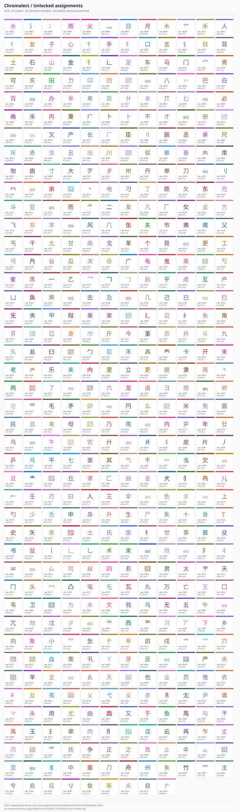

# Chromalect

**A research laboratory for visual language encoding.**

Chromalect investigates whether writing can be made easier to learn by adding reversible, digital-only visual layers: **stable colors for graphemes and reusable components, semantic families, compositional phonetic notation, tone and prosody marks, and optional mnemonic animation**.

**Status:** the first Mainland Standard Mandarin simplified-Chinese tranche is **source-aligned across all 1,000/1,000 characters** (724 multicomponent, 276 atomic), with **zero unmapped** in the verified October 21, 2026 GitHub Pages build. The independent Rust pipeline renders the original Chinese Make Me a Hanzi outlines, assigns paths to documented component identities, and publishes reproducible per-glyph source evidence and diagnostics. The active **additive v0.6 component palette has 520 identities**; all 518 v0.5 identities and the immutable 513 v0.4 identities retain their original forms and colors. Full CI passes 48 Rust tests and an all-1,000-card catalog/Marker/Direct color audit. The [live coverage JSON](https://sguzman.github.io/chromalect/glyphs/coverage.json) and [evidence report](docs/mandarin-coverage-evidence.md) document the verified coverage. **Automated geometry correspondence remains pending independent visual/linguistic review.** This is not a completed human learning study or a finalized phonetic alphabet.

## Ontology and independent project structure

Chromalect contains its own [constitution](CONSTITUTION.md), [agent guidance](AGENTS.md), and versioned [formal multilingual ontology](ONTOLOGY.md). The ontology publishes **37 entity types**, **39 typed relations**, [JSON Schema definitions](ontology/vocabulary.schema.json), and a [source-grounded Mandarin instance graph](ontology/specimens-v1.json). The [public ontology gallery](site/ontology.html) exposes these distinctions independently of the Mandarin color prototype.

Ontological types support writing systems, alphabets, graphemes, phonemes, words, morphology, lexical meaning, prosody, and the relationship between evidence and reversible visual encodings. Types do not imply that corresponding corpora or learning experiments are already complete. The independent repo hosts the ontology and presentation; an external registry may link here but is not a prerequisite.

## Starting point

The first research profile is **Mainland Standard Mandarin (Putonghua), modern simplified Chinese, and Hanyu Pinyin**. This scope is deliberately narrow enough to test while the underlying concepts can later be evaluated on Latin alphabets, Arabic, Hangul, other Chinese language varieties, and additional writing systems.

### The core experiment

Compare a plain rendering with alternate overlays of the *same underlying text*:

1. **Identity:** every normalized reusable component gets a stable, uniquely assigned color.
2. **Semantics:** semantic families may optionally influence hue neighborhoods; **distinct identity and recognition take precedence**.
3. **Structure:** decomposition reveals component boundaries and positions.
4. **Historical sound clues:** identify which component plays a phonetic role *in this character*, if any.
5. **Actual pronunciation:** a separately designed compositional visual phonetic code, ideally inside the glyph cell, plus a clear fallback to verified phonetic transcription.
6. **Prosody:** conventional tone marks/contours, with contextual pronunciation kept distinct from citation readings.
7. **Motion:** optional, meaningful animations that aid learning, never mandatory or permanently moving.
8. **Plain mode:** turn all layers off and recover the original text.

**Hard rule:** a component never changes its assigned identity color simply because it appears in a different character. The same shape cannot be recolored stroke by stroke for decorative effect.

## What this repository is

A repository for hypotheses, competing visual encodings, reproducible component data, validated rendering tools, and controlled experiments.

It is **not** a branch of another knowledge base or a general language-learning platform. The SVG pipeline is written in Rust and GitHub Pages hosts the static browser prototype. More extensive software architecture remains undecided.

## Real colored character strokes

The [stroke gallery](site/strokes.html) demonstrates **12 actual Chinese glyphs made of separately colored component strokes**, with machine-readable [path ownership](data/catalog/colored-strokes-v0.1.json). The v0.4 colors remain intact. The Rust [glyph pipeline](tools/glyph-pipeline/README.md) builds a separate SVG for each assigned character; its source-backed importer handles exact leaf ownership for nested and enclosing component structures and whole-component atomic glyphs. The generated [coverage report](https://sguzman.github.io/chromalect/glyphs/coverage.json) distinguishes mapped and unmapped characters. [Source diagnostics](https://sguzman.github.io/chromalect/glyphs/diagnostics.html) document the source audit and remaining review qualifications, while [geometry contact sheets](https://sguzman.github.io/chromalect/glyphs/review/) show native-font glyphs alongside source SVGs for visual review. The [portable mapping manifest](https://sguzman.github.io/chromalect/glyphs/mappings.json) publishes component IDs, palette values, and source-path ownership for all currently rendered glyphs. Separate [alternate-decomposition comparisons](https://sguzman.github.io/chromalect/glyphs/alternatives/) (8 cases) and [partial source-ownership previews](https://sguzman.github.io/chromalect/glyphs/unknown-components/) (27 cases, with unresolved paths in neutral gray) support further analysis. Neither research queue is included in Direct mode, Marker mode, or the active coverage figure. The [hierarchical derivation manifest](https://sguzman.github.io/chromalect/glyphs/hierarchical-derivations.json) identifies 73 additional source-derived component assignments admitted through subglyph decomposition, stroke-index agreement, and normalized path-geometry checks. These are research candidates, not independently certified mappings. A separate, pinned [secondary evidence manifest](https://sguzman.github.io/chromalect/glyphs/hanzivg-transfers.json) documents HanziVG Chinese groups and independently aligned AnimCJK simplified-Chinese stroke-count decompositions, including 15 matched donor subglyph refinements. The existing Chinese Make Me a Hanzi outlines remain the rendered geometry; source artwork is not silently substituted. See [third-party notices](THIRD_PARTY_NOTICES.md). None of these checks constitutes independent visual certification.

## Public color references

- [Human-readable color registry](site/colors.html): component identities, 24 written Pinyin initials, 33 Pinyin finals, and all five citation-tone assignments.
- [Human-readable repository tables](docs/color-registry.md): the same token-to-color values with channel scope and examples.
- [Machine-readable pronunciation/tone palette](site/layers-v0.1.json): authoritative JSON for initial, final, and tone channels.
- [Active machine-readable component palette v0.6](palettes/mandarin-component-identity-v0.6.json): all 520 additive component identities, preserving earlier assignments exactly.
- [Historical immutable v0.4 palette](palettes/mandarin-component-identity-v0.4.json) and [v0.5 extension](palettes/mandarin-component-identity-v0.5.json): retained as versioned research records.

The displayed sound colors encode **Pinyin spelling** for the selected citation reading, not a complete phonetic analysis. The left, right, and top glyph-cell edges encode initial, final, and tone separately.

**Stroke order is not a learning objective.** Stroke paths are indexed solely to associate source outlines with component ownership; the visual system does not teach handwriting sequence.

## Mandarin first-tranche browsing

The [first-1,000 Mandarin search interface](site/search.html) uses a [generated ontology-backed Mandarin data profile](site/profiles/mandarin-1000-v1.json) to browse every cataloged character by orthography, source-backed Pinyin, component shapes/IDs, and source SVG coverage. A missing SVG is recorded as unresolved, not invented. This profile binds the existing data to the shared ontology; no other language implementation is introduced.

## Web presentation prototype

The [static GitHub Pages prototype](site/index.html) uses independent **off/direct/marker** settings for component identity, orthographic Pinyin initial/final, and tone; semantics are unavailable until source-backed meaning data exists. Direct component mode uses source-aligned colored stroke geometry where available and a cell-level fallback elsewhere. See the [layer architecture](docs/web-layer-architecture.md), [machine-readable layer schema](site/layers-v0.1.json), and [one-time Pages setup](site/README.md). Publication requires GitHub Pages to be enabled for Actions in repository settings.

## Semantic symbol composition experiment

The [semantic symbol lab](site/semantic-lab.html) uses a [versioned semantic grammar](docs/semantic-expression-grammar-v0.1.md), a [typed recursive schema](ontology/semantic-expression-v0.1.schema.json), and [illustrative machine-readable expressions](site/semantic-grammar-v0.1.json) to explore an **emoji-first, variable-length expression layer**, with machine-readable operators underneath and optional technical notation for selected senses: single and multiple reusable pictograms coexist, with no arbitrary maximum or uniqueness requirement. Written meanings remain independently available, and unclear pictograms can be omitted. The [experiment design](docs/semantic-pictogram-pilot.md) keeps character uses and word senses distinct. All examples in the lab are illustrative rather than sourced dictionary annotations. **Production semantics remain disabled** until sense provenance and independent symbol review exist; this experiment does not change the completed Mandarin glyphs, component identity colors, or sound layers.

### First-1,000 Mandarin meaning screening

The [semantic coverage viewer](site/semantic-coverage.html) and [machine-readable character ledger](data/semantic/mandarin-1000-v0.1.json) now separate **source intake**, **initial emoji screening**, and **independently verified production**. As of the October 22, 2026 initial screening, all 1,000 ranked characters have a pinned provisional Unihan definition, ranks 1–200 have explicit screening decisions, and 140 have experimental emoji candidates. The remaining 60 screened characters were deferred rather than assigned unclear imagery; 800 await screening. **None of these candidate records is a production-verified semantic mapping.** The [methodology](docs/mandarin-semantic-screening.md) preserves each character's potential senses and explicitly reserves an independent, currently unpopulated whole-word semantic layer, for which toggles can eventually be separate.

## Radical, component, and character catalogs

The [human-readable catalog](CATALOG.md) distinguishes **modern radicals (201 principal + explicitly listed variants)**, **214 traditional Kangxi radicals**, **513 original v0.4 component color identities** (extended additively to **520** in v0.6), and **characters 0001–1000** in ten 100-character pages. Their [machine-readable JSON and inverse indexes](CATALOG.md) preserve the original analyses; a generated, source-aligned catalog now has complete first-tranche SVG coverage. Third-party data attribution is recorded in [THIRD_PARTY_NOTICES.md](THIRD_PARTY_NOTICES.md).

## Documentation map

| Document | Role |
| --- | --- |
| [Formal ontology](ONTOLOGY.md) | Typed multilingual classes, relations, evidence and encoding semantics |
| [Ontology instance graph](ontology/specimens-v1.json) | Source-grounded typed example and provenance |
| [Vision](docs/vision.md) | Motivation, scope, constraints |
| [Terminology](docs/terminology.md) | Precise linguistic and design terms |
| [Architecture](docs/architecture.md) | Conceptual information model; no code |
| [Color and rendering](docs/visual-encoding.md) | Identity invariants and independent channels |
| **[Component color policy](docs/component-color-policy.md)** | What gets colored, variants, nesting, and invariants |
| **[Palette v0.1 preview](palettes/mandarin-component-identity-v0.1.svg)** | Exact colors for 40 Mandarin components |
| [Palette registry](palettes/mandarin-component-identity-v0.1.json) | Machine-readable versioned color IDs and groups |
| [Pilot compound specimens](specimens/mandarin-component-pilot-v0.1.json) | Testable structural decomposition candidates |
| [Phonetic notation](docs/phonetic-notation.md) | Sound-glyph research and falsifiable constraints |
| [Mandarin baseline](docs/mandarin-baseline.md) | First language and orthographic targets |
| [Reference corpus](docs/specimens.md) | Controlled test cases; avoid misleading samples |
| [Data and licensing](docs/data-sources.md) | Potential sources and their license risks |
| [Experiment protocol](experiments/README.md) | Versioning, reproducibility, comparison rules |
| [Experiment 0001](experiments/EXP-0001-component-identity.md) | Stable per-component colors |
| [Experiment 0002](experiments/EXP-0002-featural-pronunciation.md) | Constructed visual sound notation |
| [Decisions](decisions/README.md) | Accepted, tentative, and rejected choices |
| [Roadmap](docs/roadmap.md) | Research-first development sequence |
| [Contributing](CONTRIBUTING.md) | Proposal and documentation discipline |

## Unfrozen component palette (v0.4)

**[v0.4 methodology and results](docs/perceptual-palette-v0.4.md)** · [v0.4 registry](palettes/mandarin-component-identity-v0.4.json) · [comparison](palettes/perceptual-comparison-v0.4.json) · [v0.3](palettes/mandarin-component-identity-v0.3.json) · [v0.2](palettes/mandarin-component-identity-v0.2.json) · [v0.1](palettes/mandarin-component-identity-v0.1.json).

The original 40 are **not frozen** in v0.4. Their assigned colors can change between versions. A component's color remains constant *within an active version*. The standard contains duplicate shapes and 30 descriptive placeholders. This is an exhaustive **assignment for the transcribed reference inventory**, not a finished within-glyph renderer or a complete list of every possible Chinese character component. The [policy](docs/component-color-policy.md) explains the distinction.

## Why version experiments?

A beautiful rendering can be linguistically wrong. A pretty encoding can fail to be reversible. An attractive color palette can make characters less legible. Each scheme must therefore be explicit, testable, and reproducible; designs are not silently overwritten with unrelated rules.

## Current principles

- Preserve the source Unicode text independently of every visual overlay.
- Document assumptions and provenance; never treat an image mockup as validated linguistic analysis.
- Separate **component identity**, **component role**, **meaning**, **pronunciation**, and **display style**.
- A character may have multiple readings; context can change pronunciations and meanings.
- Use exact, uniform per-component fills before trying embellishments.
- Do not import third-party linguistic corpora or font outlines without reviewing their licenses.
- Visual density is adjustable by the learner; full information is a valid study mode.
- Accessibility means every encoded dimension can be inspected without reliance on color alone.

## License

The repository has the existing [MIT license](LICENSE). Third-party data and fonts may have different terms; the repository license does not supersede those terms.
